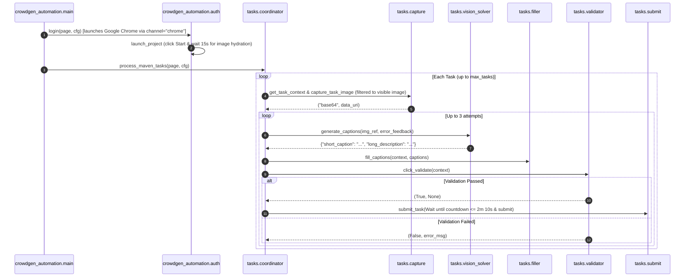

# CrowdGen Maven Automation Architecture

This project automates image captioning and description tasks on CrowdGen Maven using Playwright in Python and OpenRouter Multimodal Vision AI, adhering to NASA JPL Rule 4 (≤ 60 lines per module).

## Sequence Diagram

## Modules (NASA JPL Rule 4 - ≤ 60 Lines)

- `crowdgen_automation/config.py`: Environment configuration and typed dataclass.
- `crowdgen_automation/instances.py`: InstanceConfig dataclass and dynamic Python module loader.
- `crowdgen_automation/auth.py`: Authentication, persistent browser profile verification, and captcha wait.
- `crowdgen_automation/keep_awake.py`: Windows system sleep prevention assertion.
- `crowdgen_automation/browser.py`: Chrome browser session manager supporting native profile and CDP.
- `crowdgen_automation/main.py`: Parallel worker orchestration with CDP and native profile support.
- `crowdgen_automation/tasks/capture.py`: Frame detection and element snapshot / URL extraction.
- `crowdgen_automation/tasks/vision_solver.py`: Multimodal Google AI Studio and OpenRouter free-tier vision models with self-healing feedback.
- `crowdgen_automation/tasks/key_pool.py`: Multi-key rotation and dynamic cooldown management for OpenRouter API keys.
- `crowdgen_automation/tasks/filler.py`: Slow humanized character-by-character typing with delay pacing into caption fields.
- `crowdgen_automation/tasks/validator.py`: "Validate" button trigger, success alert detection, and DOM error message parser.
- `crowdgen_automation/tasks/submit.py`: Direct submission trigger, confirmation modal handling, and optional countdown timer monitoring.
- `crowdgen_automation/tasks/unit_loader.py`: Unit transition tracker and automated page reload polling on empty task queues.
- `crowdgen_automation/tasks/caption_cache.py`: Persistent disk and in-memory cache remembering last generated captions across crashes/retries.
- `crowdgen_automation/tasks/coordinator.py`: Task processing lifecycle loop with auto-recovery and self-healing retry coordinator.
